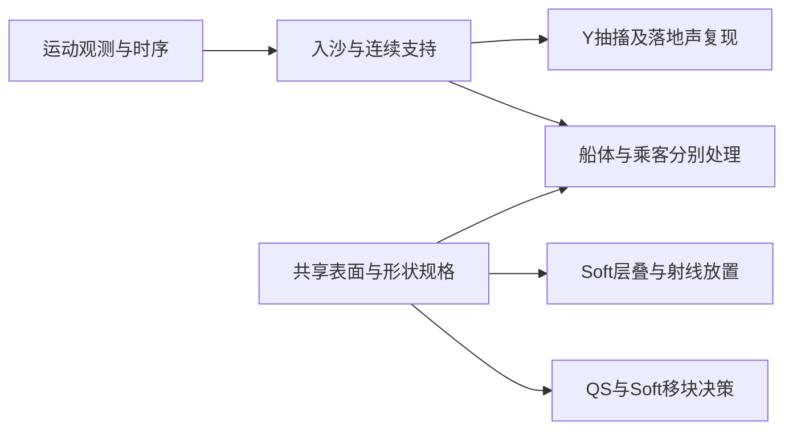

# 运动与方块交互专项（不修复）

本文用O-BC/N-SRC说明路径，用H说明原因假设。U的OBS-07最近未复现，OBS-09/11缺现场双端数据；**没有认定三者同一根因，更没有宣称修复**。源码入口键见[README](README.md)，当前函数和行号基于main 0c32951。

## 1. 一次tick中谁决定玩家位置

[SinkEngine](../../src/main/java/art/tiary/mfqm/physics/SinkEngine.java#L25)在LevelTick END遍历LivingEntity：先做active玩家历史位移校正（L63），再取当前接触（L66），写速度/清fallDistance/加属性/发速度包（L82–92）。[SinkMath.limitPlayerStep](../../src/main/java/art/tiary/mfqm/physics/SinkMath.java#L20)以lastVertical和组合移动属性给出预算；超过阈值由connection.teleport纠偏（ENGINE L129）。客户端[ClientSinkState](../../src/main/java/art/tiary/mfqm/client/ClientSinkState.java)只处理快照/挣扎意图，Vanilla本身仍积分重力/碰撞并发送移动包。

因此，**求解器输出vy、客户端积分后vy、网络包中的位置、服务端接受位置不是同一个量**。历史CSV的vy是END求解后值，不能用它直接积分重建玩家Y，也不能以它证明客户端没有快速穿入。活跃玩家预算先于新采样，但新入池之前data.active=false，首次接触之前已接受的位移不会被该分支倒回。

### H-运动耦合：OBS-07 / 09 / 11

| 代码事实 | 可能后果（H） | 缺少的验证 |
| --- | --- | --- |
| 每tick速度包 + 条件teleport，与Vanilla积分并存 | 延迟包/确认包往返形成可见回拉；不是仅调用teleport就必然抖动 | 两端pre/post Y/vy、correction count、包时间与确认；没有这些字段的CSV不能诊断因果 |
| 接触判定0.05脚探针、Soft0.85、Mud离散碰撞/边缘 | 临界点切换active/ground/预算上升上限（浅Mud0.5，其余0.05） | 临界±0.01重复进入，边缘与主材料、shape和collision上下文 |
| solver对快降/2或/10，再减0.08净重力项并夹vy≥−0.25 | 可能与LivingEntity.travel重力/玩家预测不同步；夹函数值不等于终端实际下降速度 | 生物travel顺序与玩家网络顺序分别测，不能拿猪代替玩家 |
| server END把fallDistance清零，未处理客户端落地历史 | move/checkFallDamage/声音可能早于清理；声音与实际扣血不一定同时发生 | 两端fallDistance、onGround、hp、sound ID及碰撞前后tick |

原版三类多个分支写motionY、web、fallDistance和onGround，并结合随机与时钟；原版净曲线依赖1.7.10引擎顺序。现netY公式是003注明的现代近似，不是原版常量的数学等价式。要检验“是否重复计算重力”，须记录求解前后的真实velocity与travel/包处理时序，不能从`-0.08`字面量直接定罪。

### 历史证据能与不能证明什么

任务003日志[04](../../logs/task-003/04-first-client.log)暴露仅速度包不足；[09](../../logs/task-003/09-position-budget-regression.log)为位置预算后回归；[10](../../logs/task-003/10-corrected-client.log)有24场景和维度句柄故障；[15](../../logs/task-003/15-final-clean-build-gametest.log)/[16](../../logs/task-003/16-final-client.log)包含最终生命周期修复后验证。这些构建阶段不能混为“最终全部重测”。

本轮只读统计[evidence/historical-trace-audit.json](evidence/historical-trace-audit.json)列逐文件行数/最大接受下降步长。200行case每步按相邻tick计算，不作缺帧插值；**原CSV没有fallDistance、correction_count、sound事件、客户端Y**。跳跃/teleport产生正ΔY也不能自动叫“抖动已复现”。旧1.7.10轨迹、水体验基准与高延迟轨迹均缺失。

具体例子：[QS fast_fall](../task-003/traces/phase2/quicksand_fast_fall_13024_14.csv)在13027tick仍none/Y65.94159998，13028首次quicksand/Y64.82596794、求解后vy−0.25，下一tick接受Y64.57596794。QS表面Y65，首次记录的脚穿透约0.174格；[Soft fast_fall](../task-003/traces/phase2/soft_quicksand_fast_fall_16958_14.csv)16960none/Y66.85→16961接触/Y64.67596794、求解后vy−0.25。这里2.174格步长包含空中至首次接触，不是持续材料内终端速度或2.174格“入面后穿透”。这些数值只说明为什么必须记录首次接触前后，不能冒充旧版/水的速度比较。

### 003.5-B建议顺序

1. B-MOTION-01先补可关闭观测，保留现有行为作为对照；这是下一轮计划，本轮不实现调试器。
2. B-MOTION-02明确一次接触的运动权威与顺序，独立给入射惯性/连续支持/离开定义；测试首次接触最大穿透与稳定段，而不是永久Y=0。
3. B-MOTION-03在相同时间轴处理落地历史，只在已确认材料接触范围处理材料造成的下沉；普通跳崖/离池再落下不得消音或免伤。
4. 通过低延迟后再测50/150/300ms和低TPS。不要先关位置同步掩盖症状；乘船移动独立见[Boat](BOAT_COMPATIBILITY_AUDIT.md)。

建议字段：side/tick、entity UUID、dimension、material/cells/immersion/surface、pre/post Y与deltaY、pre/post vy、fallDistance、onGround/horizontalCollision、jumpHeld、lastVertical、correction count/reason/accepted packet time；声源、sound ID、health变化和DamageSource另表。字段清单是测试设计，当前trace工具没有这些全部字段。

## 2. 方块形状、堆叠与内部射线：OBS-04 / 12

旧[Soft.func_149719_a](../../../research/task-001/evidence/BlockSoftQuicksand.analysis.txt#L92)在上方同一`this`时将下层bounds设1.0，否则0.85；原[字节码](../../../research/task-001/evidence/MoreFunQuicksandMod__main__blocks__BlockSoftQuicksand.bytecode.txt#L66)可核对分支和两个常量。现[模型](../../src/main/resources/assets/mfqm/models/block/soft_quicksand.json)顶13.6/16，[SinkingBlock.getShape](../../src/main/java/art/tiary/mfqm/physics/SinkingBlock.java#L30)恒profile高度，无连接state或邻变模型选择。生理[列采样](../../src/main/java/art/tiary/mfqm/physics/ContactSampler.java#L35)补面并不会修改模型，所以同类层叠存在视觉空带的结构性原因明确。

原规则只判**同类上块**；SS上放QS/Mud是否也应填满属于现代连接策略待批准。修复必须分离：渲染/outline、实体collision、camera/眼采样、放置hit shape。Mud碰撞0.7不要求把Mud全部视觉压成0.7；QS/SS空collision也不要求outline为空。

当前outline非空、没有自定义交互/可替换规则。Vanilla BlockGetter.clip用ClipContext选择的shape求命中，BlockItem.place使用BlockPlaceContext给出的clickedPos/canPlace；内起点与hit.face可令邻格成为头顶/表面，这是OBS-12的一种H。另一H是纠偏后眼位置与客户端hit位置不同。尚无用户hit数据，不能确定是哪一种，也不能说旧版射线一定穿透材料。

B-GEOMETRY先建立共享的表面/连接规格；B-INTERACT再定内部射线是否跳过自己所在格、是否仅限核心材料、是否保留选中破坏与桶交互。禁止全局关闭所有MFQM shape：会影响选中、挖掘、边缘、射线及其他实体，而且不能保证服务器放置合法。

## 3. 重力、更新与转换：OBS-13不是统一FallingBlock问题

三旧类均extends Block。其关键分支如下（O-BC存在，未旧实机）：

| 材料 | 旧规则及精确入口 | 当前 | 后续验证 |
| --- | --- | --- | --- |
| QS | func_149674_a；LiqFixer时return；邻岩浆→MFQM.SandBlock；随机1/5，下方`!func_76220_a && func_76222_j`时向下一格setBlock、删原格；加入/邻变调度 | 普通Block无这些更新；copy(Blocks.SAND)只copy属性 | 空气/可替换植物/水/固体分别核对旧Material映射；随机延迟记录，不凭一次等待失败定论 |
| Soft | 同类方法，随机1/2，下移保留metadata；岩浆→原版sand | 无调度/移块；新state也无旧meta纹理选择 | 同类叠柱、meta0/1/2、下方材料、区块卸载重进 |
| Mud | 完整自有方法表没有对应随机下降覆盖；碰撞几何与挖掘有独立规则 | 无自动下降；不能仅凭此叫旧版回归 | 保留Mud不下降作为忠实候选；若用户希望它也下落，明确是新规则 |

原[QS字节码](../../../research/task-001/evidence/MoreFunQuicksandMod__main__blocks__BlockQuicksand.bytecode.txt#L1299)func_149674_a包含offset410向下setBlock、419删除原格；[Soft字节码](../../../research/task-001/evidence/MoreFunQuicksandMod__main__blocks__BlockSoftQuicksand.bytecode.txt#L1514)对应offset413/422。这不是创建EntityFallingBlock的算法。

LiqFixer在MFQM静态初始化false，但CustomWorldGen生成期间会置true再复位（[来源](../../../research/task-001/evidence/CustomWorldGen.analysis.txt#L87)），不能把它误写成已配置的“重力总开关”。水邻接局部变量存在也不等于实际有水转换分支。原Material.func_76220_a/func_76222_j的旧SRG语义与第三方材质需旧引擎补证，不能把判定改成无条件空气检测还宣称一致。

若选择沙式下落实体，须另批准：掉落实体碰撞/乘客、玩家包夹、落地放置、metadata/物品、卸载/复制和世界生成的影响。B只恢复被批准的QS/Soft条件移动或明确现代替代，不批量改Mud/所有材料继承FallingBlock。

## 4. 其他交互缺项

- QS/Soft旧普通采集给沙、丝触自身；Mud按MudBallID可掉4球。当前self loot是明确差异，不应与“注册掉落GameTest通过”混为旧掉落恢复。
- 三类旧func_149737_a有未着地挖掘限制，现未移植；必须摆脱旧onGround伪装后再定标准，不要把现代客户端永远判离地。
- 旧非Living web分支未恢复，影响掉落物与Boat；SS/Mud附带触手调用属于未来实体依赖，不为修核心交互偷偷加实体。
- 混合材料新主材料按体积/优先级一次结算有证据，但列扫描边界/主材料与眼材料不同、原生水接壤、超大AABB均需单独验收。

图表示修复依赖，不表示上述症状已经查明同一个根因或已解决。
