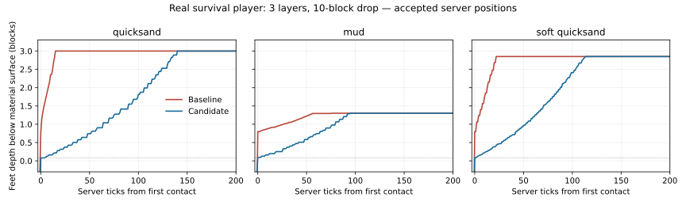

# Test evidence and acceptance status

Target: MC1.20.1 / Forge47.2.0 / Java17. User-facing dates Asia/Shanghai; raw logs UTC. Status is specific to the evidence cited, not a blanket acceptance claim.

## Automated regression

[`24-delivery-validation.log`](evidence/logs/24-delivery-validation.log): **BUILD SUCCESSFUL**, 23JUnit (original18 +5new), 20required Forge GameTests (original15 +5new), zero failures. Original test source/assertions are unchanged relative to main79aac86. New tests:

- MotionMathTest: entry limits including extreme input; distinct material/depth/struggle curves; bounded delayed/low-TPS budget; conditional landing versus outside/passenger/upward/fast fall; finite policy validation.
- MotionGameTests.sweptThinLayerEntryDissipatesFastFall: first sweep with incoming vy−4 cannot exceed entry depth; pre-move fall history replaced.
- actualMobDisplacementIsBoundedAfterContact: checks measured entity displacement rather than solver vy over40live server ticks.
- exitAndLifecycleDoNotEraseOutsideFall: leaving retains outside velocity/fallDistance; transient phase resets.
- controlledLandingDoesNotGrantOutsideFallImmunity: actual causeFallDamage reduces HP outside while confirmed material landing rejects inherited history.
- naturalPigFallsAndEntersWithinDepthBudget: AI-enabled pig must actually fall >2blocks, make contact and respect the first entry limit; a floating fixture cannot pass.

These are server GameTests, not real network clients or audible-output tests. Dimension/clone/removal/exemption coverage in the original15 remains automated; unperformed current-build manual lifecycle cases are not promoted to client passes.

## Real survival player matrix

Initial baseline: da60f10. Candidate matrix: f73565d (ordinary finite/unmounted kinematics match finaldd99b5d; subsequent changes added observation/fixtures, finite-input guards and preserved the original mounted fallback). Each has27 real-player fixtures across three materials ×1/3/17layers ×0/3/10blocks. Each fixture has260server settlement records; exact post-contact durations are in CSV. Inputs idle during this matrix. Separate real keyboard sessions cover walk1500ms, sprint chord1500ms, Space200ms, heldSpace2500ms for all three materials in both baseline and candidate integrated clients; dedicated Observer also repeated these actions.

| Material,9player cases each | Baseline max first depth | Candidate max first depth | Baseline correction count | Candidate count | Candidate min measured local client ΔY |
|---|---:|---:|---:|---:|---:|
| quicksand |1.000|0.080|192|20|−0.030000|
| mud |1.300|0.080|316|4|−0.019678|
| soft_quicksand |0.796526|0.080|333|4|−0.033000|

Depth is blocks; local ΔY is blocks/client tick. Default candidate terminal is0.055blocks/game tick and remains pending gameplay approval. Server END position differences can contain multiple client moves, and can exceed0.055; those values are retained in raw JSONL/CSV, not hidden or called solver output. Recorded player corrections total841→28 across7020samples each. This is a functional comparison under the actual logged container load, not a controlled statistical performance benchmark. Occasional corrections remain and can be visible. The user's intermittent surface twitch remains **not proven reproduced or fixed**.

The figure uses real server accepted positions (corrections included), three-layer10block player cases. It is not an old-game reference curve.

## Pig fixture validity

Initial suites each produced54files, but18elevated pig cases with NoAI never descended. Those are INVALID, retained for audit, and excluded from contact coverage. The9height0NoAI pig cases are also not substitutes for natural-pig validation. Corrected baseline394f3d1 changes only fixture code and development JVM limits from da60f10; patch and tree hash are retained. Natural AI/gravity pig reruns use distinct pigfix_base / pigfix_cand prefixes and are assessed separately. See final evidence index for case completeness; filenames alone are never a pass.

## Real landing and external controls

Dedicated test operator Observer, candidate runtime f73565d (same landing code as final), OpenAL No Output backend started successfully:

- `manual_player_stone_L1_H10`, token7f9a9032: real fall distance9.667067, fall hurt request7.0; requested client sound IDs `minecraft:entity.player.big_fall`, `minecraft:block.stone.fall`, `minecraft:entity.player.hurt`. This proves ordinary falls were not globally muted or made immune.
- `manual_player_water_L3_H10`, tokencfaa244f: splash and underwater-enter callbacks; this260tick fall observation does not validate indefinite underwater survival. Operator later drowned normally after the trace.
- `exit_soft_cliff`, token in trace filename: actual W5000ms carried the survival player from the edge of soft sand to an external dry stone landing platform. Server fall distance8.584353, fall hurt6.0 and the same vanilla big-fall/stone-fall sound callbacks. Controlled material history did not persist as outside immunity.
- The real candidate player matrix has minimumHP20 throughout its260tick windows. No high-fall sound callback was recorded in those idle candidate material cases. These are callback/HP observations, not proof of audible speaker playback. Baseline first run had no usable audio backend and cannot support acoustic equivalence.
- `action_qs` and `action_qs_valid` were attempted while the operator was dead; they contain no settlement samples and are INVALID. Subsequent `action_qs_alive`, `action_mud_alive`, `action_soft_alive` each contain399settlement samples with54jump-held samples. They used actual native keyboard input, not manufactured movement packets.

## Dedicated two-client network coverage

Recorded separately in NETWORK_RESULTS.md and the final evidence index. Only cases with actual join logs, target traces and observer evidence may be called completed. Nominal proxy delay, actual server tick timing, connection latency field and visible corrections are different measurements. Mathematical boundary tests above never substitute for actual dedicated runs.

## Remaining acceptance limits

Candidate numerical values and gameplay feel are unapproved. Full compatibility with unrelated movement mods, real WAN loss/jitter, longer stalls, physical audible output, every real-client dimension/lifecycle edge and legacy numerical parity are not established. Any missed case is listed in KNOWN_GAPS. No boats, geometry or Task004/005 acceptance is claimed.

## Completed low-TPS and lifecycle supplement

See [measured cases](evidence/network-cases.csv) and [200-interval timing windows](evidence/low-tps-timing.json). Three deliberately loaded cases ran with both clients online and Dev still on the nominal300ms proxy: effective mean8.34/8.31/8.18TPS (quicksand/mud/soft sand). Quicksand and soft sand17layer traces have899ENDsamples, reach actual bedrock-topY48, and record no fall-hurt or fall-sound requests. They use explicit temporary regeneration; minimumHP18 reflects still-active drowning, not ordinary survival acceptance. Mud has359samples, reaches existing internal supportY63.7, HP20, no fall requests. Each sampled tick has exactly one settlement; all sampled Y/vy values are finite.

A real survival player was then sampled inside soft sand, teleported to a prepared Nether platform, and returned to the overworld. The159sample dimension_before trace is active soft_quicksand;159sample dimension_nether and dimension_return traces have materialnone, air300 andHP20. Actual attribute query returns0.10000000149011612 movement speed; HUD clears. The previously recorded real death/respawn and these transfers supplement, but do not replace, automated lifecycle tests.
