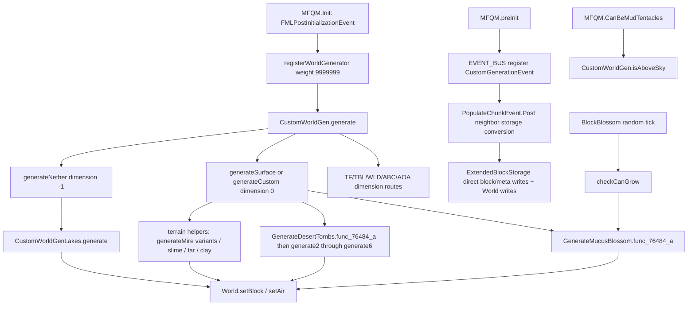

# 入口、注册与调用链

以下是静态事实或明确标注的推断；全程未运行1.7.10。精确调用偏移见 `evidence/indexes/related-call-edges.csv` 与 `worldgen-call-edges.csv`，原始指令见 `evidence/bytecode/`。方法名/descriptor消除重载歧义。

`generate`先按维度路由：-1 Nether；0由 CWG 决定 Surface/Custom，传入 AltitudeShift；1 End（空方法）。TF传 generateCustom(height32)，TBL/WLD/ABC和AOA各用配置维度及对应方法。完整有序分派代码保存在 `evidence/source-methods/CustomWorldGen__generate.cfr.txt`，不要仅凭上图推定维度优先级；维度ID冲突时先匹配分支生效。

每次路由设置 `MFQM.LiqFixer=true`，调用在try/finally中，finally清false。它是全局可变状态，可能影响流体/方块更新，不是一个 Feature 参数。现代异步生成须消除共享状态或明确串行等价上下文。

`AltitudeShift`配置文字是 Water level (62 Default, 144 TerraFirmaCraft)，实际默认62；Surface 用 `dHeight=height-62`、`wordSizer=height/62f`。不能把输入再当增量加62。42项配置声明索引见 worldgen-config.csv；getBoolean(false)是读取API兜底，不能据此把get(...,true)默认误读成关闭。

## 邻区后处理

Populate Post与常规生成分开。维度0扫描3×3邻区、各16存储段、每段16³格。GenTempleQS识别原版TNT及上方砂岩，写Quicksand0、SandstoneTrap0及垂直基础。BoP mud依旧meta与群系分型转换为Mud/草/土/砂；其中换Block不一定同步清meta。

Nether且GenHoney2：3×3邻区BoP蜂蜜/固体蜂蜜转换为MFQM对应块meta0。Betweenlands维度：5×5邻区，TBLMud→Mud3，Tar保留meta，Sludge→Mire0并补下方Mire12/Peat，含跨存储段边界分支。边界逻辑原样保留在populateChunk证据，尚未证明所有局部Y条件符合设计意图。重复Post可能重复扫描；生成顺序、邻区可用性和重入需实测。

## 扩展搜索边界

调用图不是五类封闭图：额外包括MFQM注册/配置/触手判定、BlockBlossom随机刻、World/Chunk/ExtendedBlockStorage、ChestGenHooks、刷怪笼TileEntity、方块更新副作用。Tombs/MucusBlossom虽实现IWorldGenerator，其接口generate方法为空；不能仅根据接口宣称被独立注册。未证明反射/其他模组动态调用全部覆盖。

注册和配置的字节码保存在 MFQM 文本中；每个调用精确偏移可从相关调用CSV按 `target_method=registerWorldGenerator`、`register`、`isAboveSky`过滤。生成开关在同一方法多次使用，必须保留源程序顺序，不是互不影响的概率表。
